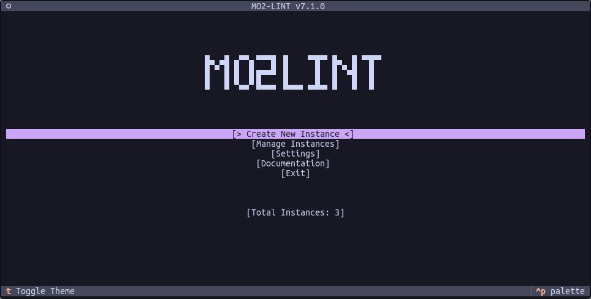

Make sure you've covered the [Requirements] page first.

## 1. Download the Binary

Grab the latest release from the [GitHub Releases page](https://github.com/Furglitch/modorganizer2-linux-installer/releases).

:::danger[Beware of Malware!]
The GitHub repo authored by Furglitch is the **only** reliable source for downloading the MO2-LINT binary.
If you have downloaded the binary anywhere else, *uninstall it immediately*.
:::

## 2. Set as Executable

Run the following command to ensure the binary has permissions to run as an executable:

```bash
chmod +x path/to/downloaded/mo2-lint
```

## 3. Install to PATH

:::note
This step is optional, but highly recommended.<br/>
The remainder of the documentation is written with the assumption that `mo2-lint` has been added to your PATH.
:::

For convenience, you can move the binary to a directory on your `PATH` so you can run it from anywhere, instead of having to navigate to the download location or type the full path every time.

Check what's on your `PATH`:

```bash
echo "$PATH" | tr ':' '\n'
```

For example, if `/usr/local/bin` is on your `PATH`, you can move the binary there:

```bash
sudo mv path/to/downloaded/mo2-lint /usr/local/bin/mo2-lint
```

## 4. Run MO2-LINT

The MO2-LINT process has two interaction modes depending on your preference: TUI and CLI.

### TUI

The TUI (Terminal User Interface) gives you a graphical interface inside the terminal, to run MO2-LINT processes without needing to fumble through command arguments and flags.



To access the TUI, start `mo2-lint` without any arguments:

```bash
mo2-lint
```

For a complete overview of the TUI layout and processes, check the [TUI Guide].

### CLI

The CLI (Command-line Interface) allows you to use in-line commands to create and manage MO2 instances.

To run MO2-LINT via CLI, run `mo2-lint` with your preferred commands and options.

```bash
mo2-lint <command> [options]  # if added to PATH
```

For a full breakdown of the available commands and options, check the [CLI Guide].

---

Continue to [Proton Setup]. This is required before you create your first instance.


[Requirements]: ./1-requirements.mdx
[Installation]: ./2-installation.mdx
[Proton Setup]: ./3-proton.mdx
[First Launch]: ./4-launch.mdx

[TUI Guide]: ../tui-guide/index.mdx
[CLI Guide]: ../cli-guide/index.mdx
