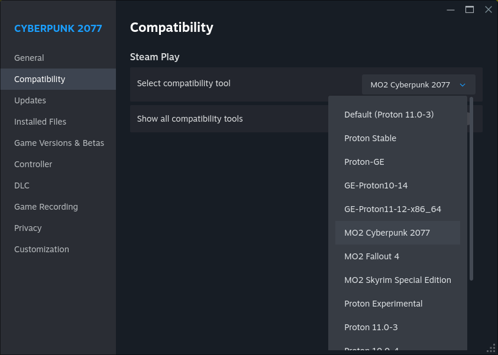
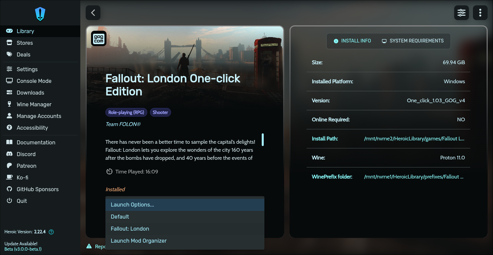

A quick checklist to confirm your first instance is set up correctly.

## 1. Launch the Game Once

Before installing an instance, you must start the game through Steam or Heroic at least once and let it load to the main menu, or the launcher if applicable. This initializes the Proton prefix that MO2-LINT depends on.

## 2. Create Your Instance

If you are using the TUI:

Launch `mo2-lint` from the terminal to bring up the TUI, then choose **Create New Instance** from the menu.
See the [TUI Guide] if more information is needed.

If you are using the CLI:

Run the following command:

```bash
mo2-lint install <game> <directory> [options]
```

A full list of supported games and available resources (plugins, script extender, etc.) is available on the [Compatibility](../resources/index.mdx) page.

## 3. Launching MO2

:::warning
Always launch Mod Organizer *through Steam or Heroic*, not by running the executable directly, even through Wine or Protontricks.
Manual execution can break the prefix.
:::

### Steam

After installing, head to the game's **Properties** in your Steam library.



Under the **Compatibility** tab, open the **Select compatibility tool** dropdown and select the custom Proton version created by MO2-LINT, named `MO2 <game>` (e.g. `MO2 Cyberpunk 2077`, as shown in the above image).

:::warning
Make sure that you have at least one other game that has the original Proton version (e.g. Proton 11, Proton GE) selected in its compatibility settings.
Otherwise, Steam may consider the original unused and remove it, which will also break the MO2 Proton version.
You can use a non-Steam game for this purpose.
:::

### Heroic

After installing, you should see a new **Launch Mod Organizer** option within the game's launch options.



## 4. Confirm It Worked

Mod Organizer should start up when you:

- **Steam:** Launch the game via Steam
- **Heroic:** Launch the game with the **Launch Mod Organizer** launch option selected.

:::tip
If something looks wrong or doesn't work at this stage, check the [Troubleshooting] guide. Most first-run problems are covered there.
:::

---

You're all set up! You should check out the [Game Guides], in case your game has any specific post-install instructions.


[Requirements]: ./1-requirements.mdx
[Installation]: ./2-installation.mdx
[Proton Setup]: ./3-proton.mdx
[First Launch]: ./4-launch.mdx

[Troubleshooting]: ../troubleshooting/index.mdx
[Game Guides]: ../game-guide/index.mdx
[TUI Guide]: ../tui-guide/index.mdx
