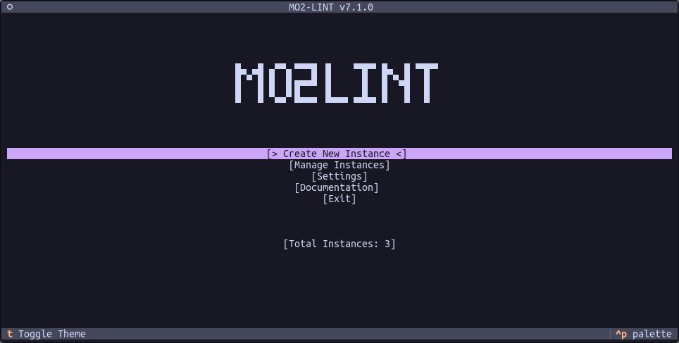
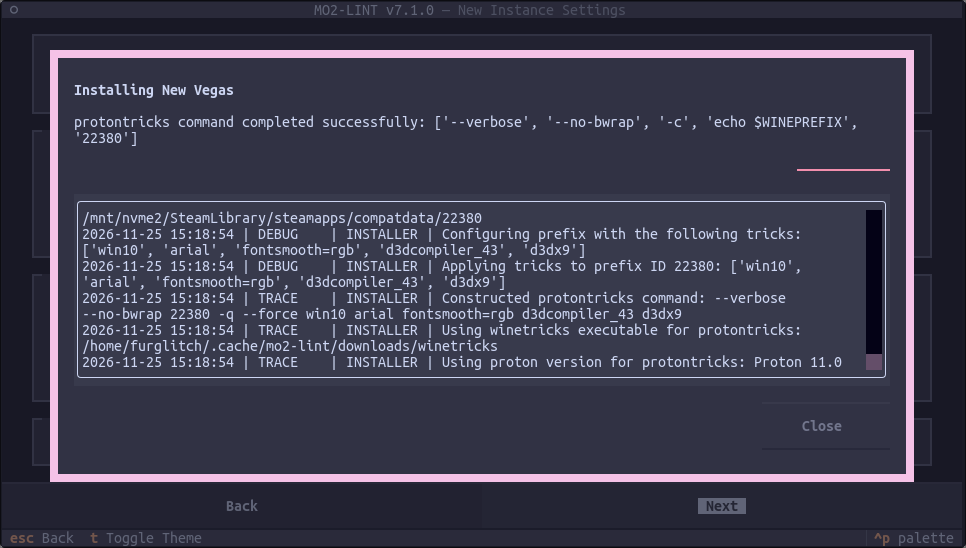
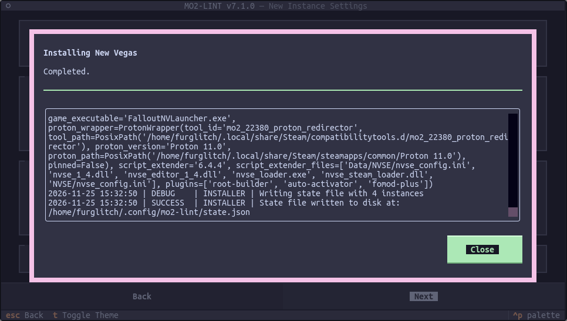

MO2-LINT includes a full-screen terminal interface (TUI) that covers all standard CLI operations. You don't need to remember any commands or flags.

:::tip
Read through [Game Guides] for your game before creating an instance. Some games need extra steps.
:::

## Opening the TUI

Run MO2-LINT without a command:

```bash
mo2-lint
```

Any in-line command (`install`, `update`, etc.) runs the CLI instead, as described in the [CLI Guide].

:::warning
To avoid rendering issues, the TUI requires the terminal window to be at least **120 × 30** characters.<br/>
If your window is smaller, MO2-LINT will show a notice with the current size until you resize it.
:::

## The Main Menu



| Menu item | What it does |
|:--|:--|
| **Create New Instance** | Set up Mod Organizer 2 for a game. See [Creating an Instance](./create.mdx). |
| **Manage Instances** | Update, pin, or uninstall existing instances. See [Managing Instances](./manage.mdx). Disabled until you have at least one instance. |
| **Settings** | Edit your default options. See [Settings](./settings.mdx). |
| **Documentation** | Opens this documentation site in your browser. |
| **Exit** | Closes MO2-LINT. |

The counter below the menu shows how many instances MO2-LINT is tracking.

## Getting Around

The TUI works with the keyboard or the mouse. The footer at the bottom of each screen lists the shortcuts available there.

| Key | Action |
|:--|:--|
| <kbd>↑</kbd> / <kbd>↓</kbd> | Move through a list. |
| <kbd>Tab</kbd> / <kbd>Shift</kbd>+<kbd>Tab</kbd> | Move between lists, fields, and buttons. |
| <kbd>Enter</kbd> | Select the highlighted item or press the focused button. |
| <kbd>Space</kbd> | Toggle a checkbox, or a plugin in a plugin list. |
| <kbd>Esc</kbd> | Go back one screen, or cancel a dialog. |
| <kbd>T</kbd> | Switch between the dark and light color themes. |
| <kbd>Ctrl</kbd>+<kbd>P</kbd> | Open the command palette. |
| <kbd>Ctrl</kbd>+<kbd>S</kbd> | Save settings (Settings screen only). |

## Progress, Prompts, and Messages

### Progress Dialog

Installs, updates, and uninstalls run in a progress dialog.



- The line under the title shows the latest step.
- The log shows the full output, at the level set by **Log Level** in [Settings](./settings.mdx). The complete log is always written to `~/.cache/mo2-lint/logs/` as well.
- **Close** stays disabled until the command finishes. The status line then reads **Completed.**, or **Did not complete. See the log above.** if something went wrong.



### Prompts

If MO2-LINT needs a decision while a command is running, such as which script extender version to install, it shows a list of options. Highlight one and press <kbd>Enter</kbd> or **Select**. **Cancel** or <kbd>Esc</kbd> closes the prompt without choosing.

### Notifications

Outside the progress dialog, warnings and errors appear as notifications in the corner of the screen, along with confirmations such as **Settings saved**.

[CLI Guide]: ../cli-guide/index.mdx
[Game Guides]: ../game-guide/index.mdx
