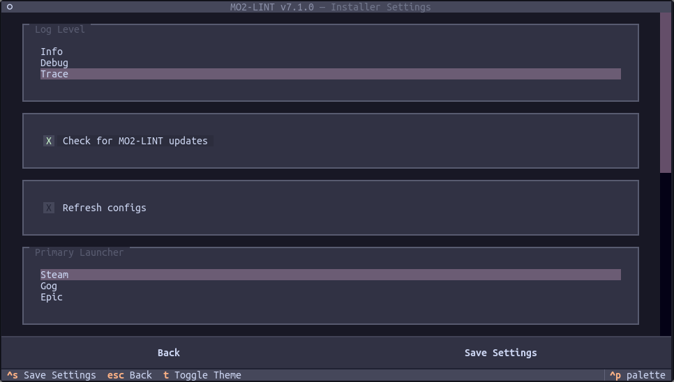
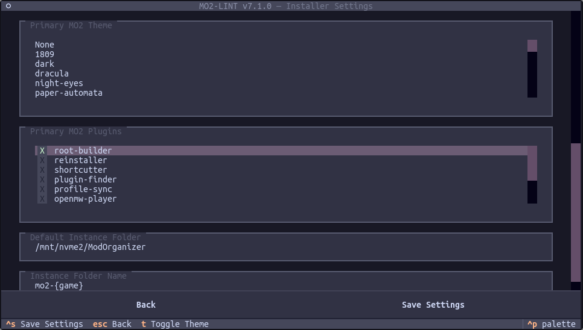

Choose **Settings** from the main menu to edit `~/.config/mo2-lint/settings.toml` without opening it in a text editor. The CLI uses the same file, so changes here also apply to CLI commands.

 

## Fields

Each field maps to a key in `settings.toml`. See [Configuration](../configuration/index.mdx) for details on each key.

| Field | `settings.toml` key | Description |
|:--|:--|:--|
| **Log Level** | `[installer] log_level` | How much detail the progress dialog shows: Info, Debug, or Trace. Log files are always written at Trace. |
| **Check for MO2-LINT updates** | `[installer] check_updates` | Check GitHub for a newer MO2-LINT release on startup. |
| **Refresh configs** | `[installer] refresh_configs` | Download the latest game, plugin, and theme definitions on startup. |
| **Primary Launcher** | `[instance] launcher` | The launcher highlighted by default when you [create an instance](./create.mdx). |
| **Primary MO2 Theme** | `[instance] theme` | The theme selected by default for new instances. **None** leaves it unset. |
| **Primary MO2 Plugins** | `[instance] plugins` | Plugins ticked by default for new instances. Toggle each with <kbd>Space</kbd>. |
| **Default Instance Folder** | `[instance.folders] root_folder` | The folder new instances are created in when you leave **Install Directory** empty. |
| **Instance Folder Name** | `[instance.folders] folder_name` | The name for each new instance's folder. Accepts `{game}` and `{launcher}` placeholders. |

:::tip
A Default Instance Folder of `~/Games` and an Instance Folder Name of `mo2-{game}` installs a Fallout 4 instance at `~/Games/mo2-fallout4`.
:::

## Saving

Press **Save Settings** or <kbd>Ctrl</kbd>+<kbd>S</kbd> to write your changes. A **Settings saved** notification confirms it, and the new log level applies straight away.

:::warning
**Back** and <kbd>Esc</kbd> leave the screen **without saving**, and don't ask first.
:::
